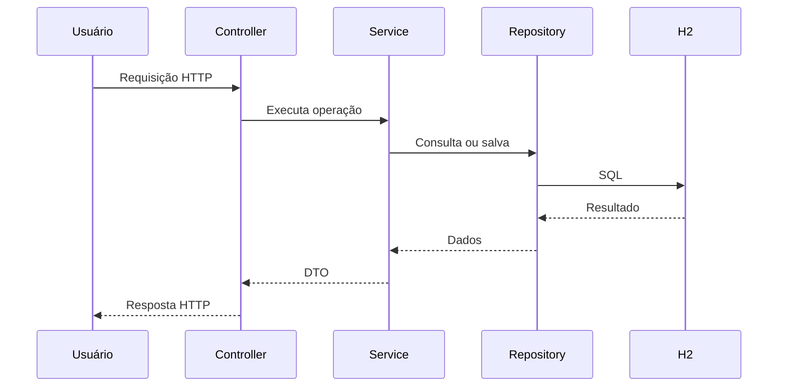
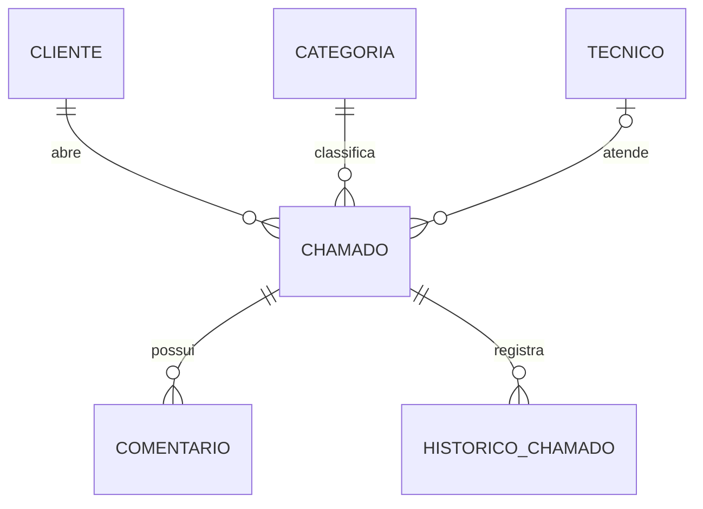

# Sistema de Chamados

Projeto desenvolvido em Java com Spring Boot para a disciplina da faculdade.

A ideia do sistema é criar uma API REST para gerenciar chamados de suporte técnico, permitindo cadastrar clientes, técnicos, categorias e controlar os atendimentos.

## Tecnologias utilizadas

- Java 21
- Spring Boot
- Spring Data JPA
- H2 Database
- Maven
- JUnit 5
- Mockito

## Funcionalidades

- Cadastro, consulta, edição e exclusão de clientes
- Cadastro de técnicos e categorias
- Criação e gerenciamento de chamados
- Atribuição de técnicos aos chamados
- Alteração de status dos chamados
- Filtros por status, prioridade e cliente
- Paginação na listagem de chamados
- Adição de comentários nos chamados
- Histórico de alterações dos chamados
- Validações e regras de negócio

## Status dos chamados

Os chamados podem ter os seguintes status:

- ABERTO
- EM_ATENDIMENTO
- AGUARDANDO_CLIENTE
- FECHADO

O sistema possui algumas regras para alteração de status e não permite modificar chamados que já foram fechados.

## Estrutura do projeto

O projeto foi organizado em camadas:

- **Controller:** recebe as requisições da API
- **Service:** contém as regras de negócio
- **Repository:** faz a comunicação com o banco de dados
- **Entity:** representa as tabelas do banco
- **DTO:** utilizado para entrada e saída de dados

## Como executar

É necessário ter o Java 21 ou superior instalado.

Para executar o projeto no Windows:

```powershell
.\mvnw.cmd spring-boot:run
```

A API fica disponível em:

`http://localhost:8080`

O banco utilizado é o H2.

## Testes

Foram criados testes automatizados com JUnit 5 e Mockito para verificar algumas regras dos chamados, comentários e histórico.

Para executar os testes:

```powershell
.\mvnw.cmd test
```

Na última execução foram realizados 12 testes com sucesso.

## Autor

Thiogo Antonio Gambeta

Engenharia de Software - Univille


## Rotas adicionais

- `GET /clientes/{id}/chamados` - lista os chamados de um cliente.
- `POST /chamados/{id}/comentarios` - recebe `texto` e `autor` no JSON.

Exemplo de comentário:

```json
{ "texto": "Chamado em análise", "autor": "João" }
```

## Diagramas simples

Fluxo de uma requisição:



Relacionamentos principais:


